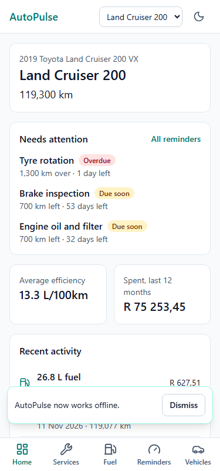
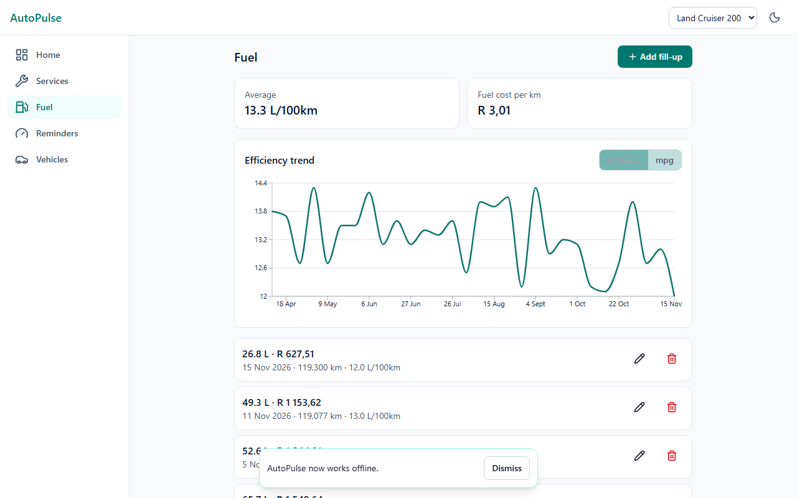
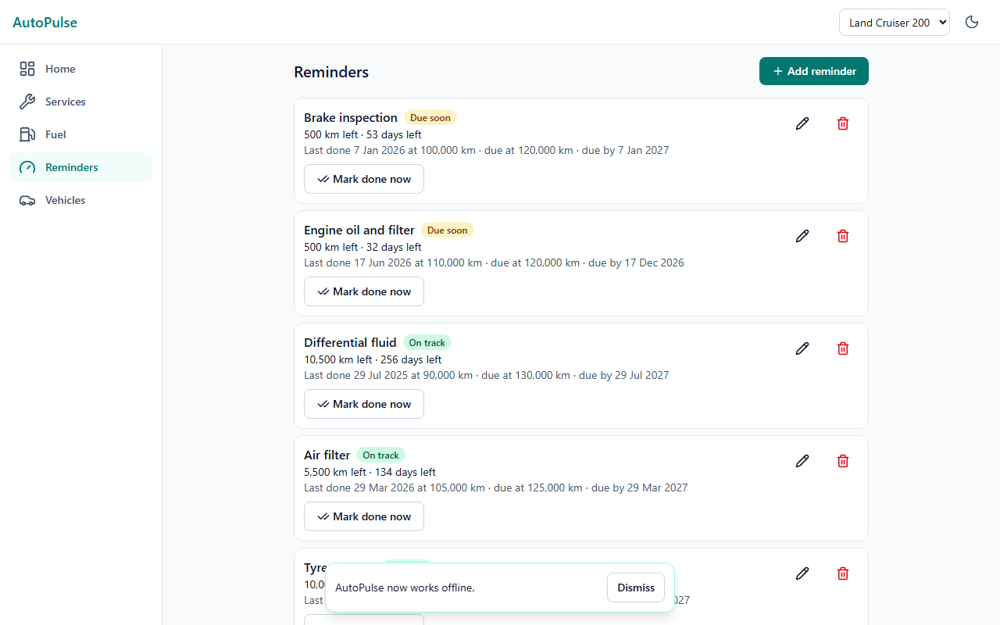
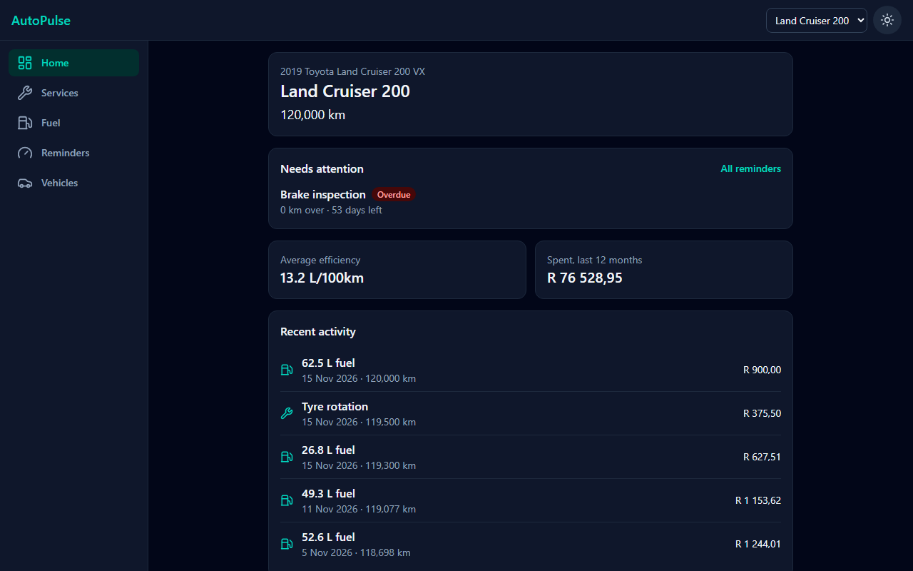

# AutoPulse

An offline-first vehicle service tracker. Log services and fuel, see real fuel efficiency and cost per kilometre, and get reminders that fire on distance or time, whichever comes first. It installs as an app and works with no connection.

**Live demo:** TBD (built and tested locally, not yet deployed)



## What to demo to a recruiter
- Open the app: a lived-in demo 4x4 (two years of fuel and service history) is already there, and the dashboard flags one overdue and two due-soon services. No sign-up.
- Go to Reminders, log a matching service on the Services screen, and watch that reminder restart itself. Then open Fuel and flip between L/100km and mpg to see the trend chart and average re-compute.
- Switch the browser to offline and reload. Everything still works, because the whole app and all data live on the device (service worker + IndexedDB).

## Features
- **Vehicles and services:** several vehicles, a quick switcher, services with type, date, odometer, cost and notes, filter by type and a running total.
- **Fuel and efficiency:** measured from full tank to full tank (part fills are folded into the segment they belong to), shown as L/100km or mpg, with cost per distance and a trend chart.
- **Reminders:** rules by distance, months or both. Status is overdue, due soon or on track, spelled out in words. Logging a matching service restarts the rule automatically, and there is a "Mark done now" button.
- **Installable and offline:** web manifest, precached app shell, and an update banner that lets the user choose when to reload (prompt mode).
- Money kept in minor units, dates as plain calendar days, dark and light theme, mobile-first at 375px.

### Phase 2
- Local notifications for due services
- Photo attachments for receipts
- CSV export and import
- Optional sync to Neon through a Netlify Function

## Stack
React 19, Vite, TypeScript (strict), Tailwind CSS 4, Dexie (IndexedDB), React Router, Recharts, vite-plugin-pwa, Vitest.

## Architecture notes
- All data is local: Dexie tables for vehicles, services, fuel and reminders (`src/db/schema.ts`). No network call is needed for any core flow.
- `src/lib/efficiency.ts` holds the efficiency maths as pure functions: a segment runs between two full tanks and includes every fill after the first one, so part fills never distort the result. The average is weighted by distance rather than averaging per-segment averages. Miles are converted to km before computing L/100km.
- `src/lib/reminders.ts` evaluates rules against the current odometer and today's date, and orders them by urgency. The "due soon" window is 30 days or the last tenth of the distance interval (capped at 1,000 km).
- Repos (`*Repo.ts`) wrap writes in transactions. Logging anything above the current odometer raises the vehicle's odometer, and logging a service restarts matching reminders (case-insensitive) without moving one backwards.
- The Recharts chart is code-split so the first load stays small.
- First launch seeds the demo 4x4 once (a flag stops it coming back after the user deletes it).

## Run locally
```bash
npm install
npm run dev          # http://localhost:5173
```
Checks: `npm run typecheck`, `npm run lint`, `npm test` (35 tests), `npm run build`. Try the installable build with `npm run build && npm run preview`.

## Screenshots
| Fuel | Reminders | Dark theme |
| --- | --- | --- |
|  |  |  |

## Status
Built and tested locally. Deploy pending.
